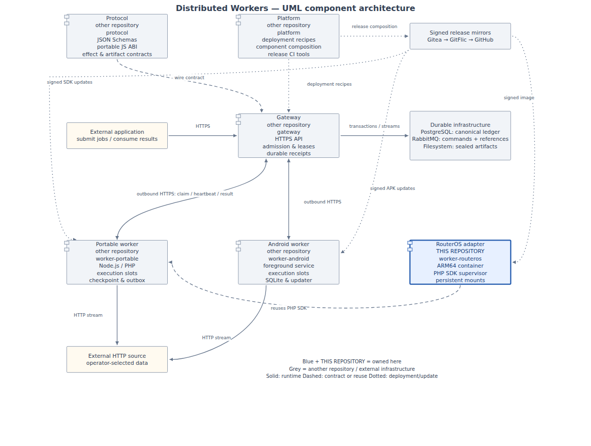

# RouterOS worker

A generic ARM64 container adapter for RouterOS, including hAP ax³. It reuses the
[portable worker](https://gitflic.ru/project/distributed-workers/worker-portable)
protocol and runtime. Configuration and executable programs are supplied by the
operator; application-specific code and data do not belong in this repository.

<!-- fleet-architecture:start -->
## Architecture and repository boundary



All six repositories show the same system. **Blue and “THIS REPOSITORY” identify the component owned here**; grey boxes show sibling repositories or external infrastructure. Solid arrows carry runtime traffic, dashed arrows show contracts or reuse, and dotted arrows show deployment or updates. The protocol applies to the gateway and both execution SDKs; deployment arrows show the principal composition entry points.

This repository owns the minimal ARM64 container, supervisor, persistent-mount contract and image packaging. The portable repository supplies the PHP execution engine; task definitions and application programs remain operator-owned. The image bootstrap pin and the currently selected signed SDK are separate versions.

Implementation: [container supervisor](container/), [image builder](tools/build.py), [bootstrap SDK pin](runtime.lock.json), [example configuration](worker.example.json).

[SVG source](docs/architecture.svg) · [Editable DOT source](docs/architecture.dot). The common model and Python-only SVG renderer live in [platform](https://gitflic.ru/project/distributed-workers/platform). From its checkout, `python3 -B tools/render-architecture.py --workspace ../.. --png` regenerates every ownership view in a workspace containing `repos/<component>`. PNG previews work on forges that serve SVG as text. SVG generation uses Python alone; PNG rendering uses a local Chromium browser. No diagram service or production configuration is needed.
<!-- fleet-architecture:end -->

The worker connects outbound, receives its server-assigned identity and reports
actual CPU, memory and storage availability. It executes local allowlisted
programs or HTTP operations and streams binary results. A persistent state volume
retains checkpoints, effect receipts and completions until the server acknowledges
them. Program hashes, leases and result hashes are checked by the shared SDK.

## Build

`runtime.lock.json` pins a signed portable SDK. `tools/prepare.py` verifies its RSA
signature and hash before placing it in an ignored build context. The public
image contains neither credentials nor deployment endpoints.

The release builder uses the official Alpine APK trust keys to assemble an ARM64
filesystem without executing foreign binaries. It runs the process supervisor
tests on the builder's native PHP. `ci/Builderfile` provides these tools:

```sh
python3 -B tools/cache_runtime.py --archive /path/to/fleet-worker-portable.zip \
  --manifest /path/to/portable-manifest.json
docker build -t fleet-router-image-builder:1 -f ci/Builderfile .
docker run --rm -v "$PWD:/workspace:ro" -v "$PWD/dist:/out" -w /workspace \
  fleet-router-image-builder:1 python3 -B tools/build.py \
  --output /out --tag v0.1.0 --commit "$(git rev-parse HEAD)"
```

`container/Dockerfile` is also available for a native ARM64 Docker builder after
preparing `.build/sdk`. It uses the same PHP adapter and supervisor.

## Small operator runtimes

Keep application dependencies outside the public image. `tools/pack_runtime.py`
builds a private bundle from an existing target filesystem. It resolves ELF
dependencies with `readelf`, without executing foreign binaries, and reuses a
library from the base image only when its SHA-256 matches. Check the resulting
`runtime-manifest.json` against the actual base before deployment.

```sh
python3 -B tools/pack_runtime.py --source /private/target-root \
  --output /private/runtime --archive /private/runtime.tar \
  --base-image /private/base-image.tar.gz \
  --executable usr/bin/python3 --python-stdlib usr/lib/python3.12 \
  --python-package /private/application-package
```

Python source and package data stay compressed in `usr/lib/python312.zip` and
are imported directly. Native extensions and their libraries remain ordinary
files. Bytecode caches are omitted; set `PYTHONDONTWRITEBYTECODE=1`. Module
exclusions are explicit operator choices, rather than a list inferred from one
successful document. Do not copy a second operating system or package installer.

For frequently imported modules, run `tools/warm_python.py --archive ... --module
application.module` once with the target Python interpreter in a staging bundle.
It adds checked-hash bytecode while preserving the source and package data, so
startup does not repeatedly compile the same modules. Other modules still use
their source fallback. Reseal the bundle manifest after warming; measure both
startup time and the resulting installed size before deployment.

Install through the sequential archive, preserving its symbolic links. Copying
loose files through a share that follows links can silently duplicate libraries.
The archive uses neutral ownership; extraction with `tar --no-same-owner` assigns
the target operator's identity rather than retaining a build host's user ID.

Put private configuration and durable state on local persistent bind mounts,
outside the replaceable container root. Scratch space may use `/dev/shm`; budget
its actual capacity and RAM separately. Images, update staging, retained results
and working data all count toward the device's available space.

## RouterOS installation

Tested on RouterOS 7.24.5, ARM64. Install the container package and enable container
support through RouterOS device-mode before deployment. Prepare an isolated VETH
interface; the worker needs outbound HTTPS and the task network selected by its
operator. No inbound application port is required.

Keep `worker.local.json`, proxy configuration and update endpoints outside Git.
Start from `worker.example.json`; provision the SDK's private update-source chain
in the order Gitea, GitFlic, GitHub. Runtime updates verify the pinned RSA key and
are applied between tasks, preserving the worker identity and durable state.

Mount configuration at `/config`, persistent state at `/state` and optional
operator-managed executables at `/programs`. Supply `/config/worker.local.json`
as the container command. Select CPU affinity and memory limits for the device's
available capacity, leaving resources for routing.

The base runtime is approximately 23 MB unpacked. Additional programs, their
libraries and working files require separate space. USB storage or an encrypted
SMB3 mount can supply persistent volumes. RouterOS SSHFS mounts may be readable
by RouterOS but inaccessible inside a user-namespaced container; verify access
from the actual container before provisioning its identity. Validate write,
rename, sync and lock operations on the state filesystem. With RouterOS CIFS,
UID 0 inside the unprivileged container may be required for permission operations;
keep `privileged=no` and protect the remote share with its server ACL.

For maintenance, create `/state/maintenance` and wait for `/state/adapter-drained`.
The supervisor finishes its current tick and then blocks new work, including
after an automatic container restart. Persistent completions stay on the state
volume. Only after this barrier may RouterOS settings or the image be changed.
Remove `/state/maintenance` to resume. The marker disappears before the next tick.

On a device with limited flash, budget the update archive as well as the installed
runtime. An in-place RouterOS repull can exhaust temporary space. Download and
verify the complete signed image first, drain/stop the worker, then remove only
the old container root and create its replacement from the verified archive.
Reuse the existing interface and persistent local bind mounts. Check the new
image identity and worker state before resuming; remove the staging archive after
successful installation. The worker identity and pending results belong on the
separate persistent volume, never inside the replaceable image root.

Avoid an inherited small `/dev/shm` ceiling that cannot hold a valid task and its
metadata. Its ceiling can match the container's actual RAM allocation; tmpfs uses
memory as data is written rather than reserving its full ceiling at startup.

Do not change settings or use RouterOS's stop command during active work: its
separate stop-time can force termination. A power loss is recovered through
persistent state and the queue lease. SIGTERM also drains a current tick without
taking another, but the maintenance marker is the persistent operator barrier.

## Releases and checks

Version-tag pipelines build and sign the canonical image on GitFlic. Gitea and
GitHub verify its RSA signature, source revision, ARM64 configuration and every
filesystem layer, then publish the same archive bytes. The signing key is available
only to the protected signing job. The ignored `mirror-git.py` publisher attempts
all mirrors independently.

```sh
python3 -B -m unittest discover -s tests -v
python3 -B -m unittest discover -s ci/tests -v
```

The adapter keeps one authenticated SDK process alive between tasks, preserving
its connection and executable fingerprint cache. Program hashes are still checked
before execution. Maintenance and stop requests drain the current task before
that process exits; signed runtime updates select a fresh process.

The process tests check draining on shutdown, immediate continuation after useful
work, restart after a signed runtime update, the persistent maintenance barrier,
and reuse of one runtime for several tasks. Hardware acceptance is performed
before publishing a new adapter implementation.

## Adaptive execution

The adapter starts the signed SDK's managed process pool. Each slot uses its own
durable state while retaining the single worker identity. CPU and memory
pressure stop admission without killing productive native jobs. Maintenance and
container stop drain the pool before the adapter barrier is written. The signed
SDK retains its own update chain independently of the minimal ARM64 image.
Configure private `concurrency.mode` as `router`; CPU/job and memory/job are
admission reservations and can be based on measured workloads. No application
schema or task-specific parser is part of this image.

<!-- fleet-examples:start -->
## Runnable examples and measured results

A local computation needs no source service:

```json
{
  "operation": "sha256",
  "input": {
    "text": "abc"
  },
  "required_capabilities": [
    "sha256"
  ]
}
```

Expected result: `{"sha256":"ba7816bf8f01cfea414140de5dae2223b00361a396177a9cb410ff61f20015ad"}`. The same task runs on Node, PHP and Android.

The [binary download example](https://github.com/hawkab/distributed-workers-protocol/blob/main/examples/mirror-download.json) fetches a public signed runtime ZIP and streams it to gateway artifact storage. Its expected SHA-256 is pinned in [the example assertions](https://github.com/hawkab/distributed-workers-protocol/blob/main/examples/benchmark/expected.json). The runner downloads the sealed artifact independently and verifies every byte. Worker task payloads are not staged as local files.

These tasks run through the shared PHP SDK in the actual ARM64 container. They require no additional application runtime or task-specific package in the image. The measured SDK version is recorded separately from the image bootstrap pin.

Run the shared client as a **producer/operator with an administrator credential**, not with a worker token. Keep the [protocol checkout](https://gitflic.ru/project/distributed-workers/protocol) beside this checkout:

```sh
mkdir -p .local
cp ../protocol/examples/benchmark/runner.example.json .local/examples.local.json
# Configure your API base and an owner-readable token file in that local JSON.
python3 -B ../protocol/tools/run-examples.py \
  --config .local/examples.local.json \
  --state .local/example-run/state.json \
  --output .local/example-run/measurements.json \
  --scenario sha256 --scenario mirror-download --repetitions 5
```

Repeat the command to resume its saved jobs after interruption. It reconciles the same idempotency keys, retains failed/interrupted evidence, and never gives a running job an overall deadline. `required_capabilities` and `resource_requirements` select a pool; `allowed_worker_ids` checks the actual executor afterward. A label alone does not select a platform. Keep these routing settings and all identity receipts private. The exported measurements contain neither endpoints, credentials nor worker/job IDs.

Measured 26–27 November 2026 (UTC+03), using SDK 0.8.4 and Android 0.8.0.

| Executor | Task | Completed / planned | Queue, median s | Execution/result, median s |
| --- | --- | --- | --- | --- |
| PHP / RouterOS ARM64 | SHA-256: abc | 5 / 5 | 0.294 | 0.960 |
| PHP / RouterOS ARM64 | ZIP stream: GitFlic | 1 / 5* | 0.300 | 120.379 |

\* Incomplete download cohort: timing uses only verified completions. Cancelled and unstarted trials remain in the full report. One completed transfer is a functional check, not an estimate of typical throughput.

Times distinguish queue wait from execution **including task work and result delivery**. They are live-system observations under existing load, not pure CPU timings. Complete cohorts use five trials each; see the [full measurements and method](https://github.com/hawkab/distributed-workers-protocol/blob/main/docs/EXAMPLES.md).
<!-- fleet-examples:end -->
